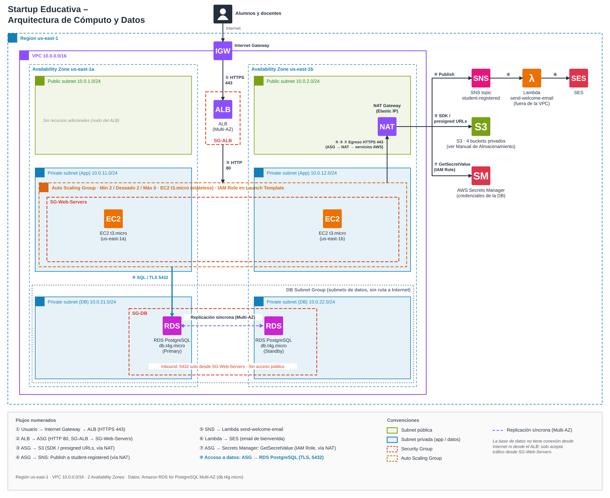
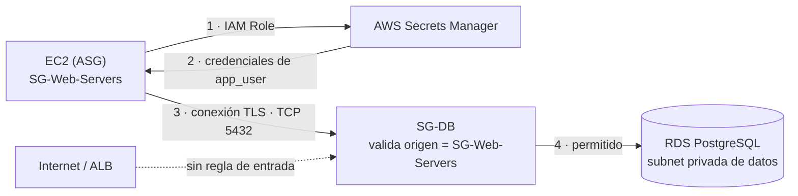
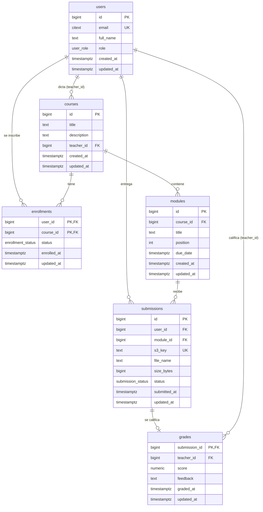

# Arquitectura de Datos — Plataforma Educativa (RDS vs. DynamoDB)

**Autor:** Matías Poletto · **Curso:** Cloud Computing con AWS · **Fecha:** 10 de noviembre de 2026

## 1. Resumen

La capa de datos de la plataforma se implementa con **Amazon RDS for PostgreSQL** en despliegue **Multi-AZ**, dentro de subnets privadas de datos y accesible únicamente desde los servidores de aplicación. Los datos son relacionales (alumnos ↔ cursos, entregas ↔ calificaciones), requieren integridad referencial, transacciones ACID y reportes con SQL, y el volumen es moderado. En ese escenario RDS cubre los requisitos con costo bajo y predecible; DynamoDB y Aurora no aportan una ventaja que justifique su complejidad o su costo. Las credenciales se gestionan con AWS Secrets Manager y los archivos de los alumnos permanecen en S3.

## 2. Contexto de la arquitectura

La plataforma corre en `us-east-1` sobre una VPC `10.0.0.0/16` distribuida en dos Availability Zones (us-east-1a y us-east-1b). Un Application Load Balancer en subnets públicas (`10.0.1.0/24`, `10.0.2.0/24`) distribuye el tráfico hacia un Auto Scaling Group (Min 2 / Deseado 2 / Máx 6) de instancias EC2 `t3.micro` stateless en subnets privadas de aplicación (`10.0.11.0/24`, `10.0.12.0/24`), protegidas por `SG-ALB` y `SG-Web-Servers`. El registro de un alumno publica un mensaje en el topic SNS `student-registered`, que dispara la función Lambda `send-welcome-email`, que envía el correo con SES (pre-entrega 3). El almacenamiento de archivos usa cuatro buckets S3 privados (`edustartup-static`, `edustartup-user-uploads`, `edustartup-logs` y `edustartup-backups`, sufijo `-prod-use1-123456789012`); la base de datos guarda solo metadatos y la *key* del objeto (pre-entrega 4). Este documento incorpora la capa de datos a esa arquitectura.

## 3. Análisis de requisitos de datos

| Dato | Ejemplos de campos | Estructura | Relaciones | Volumen / crecimiento | Consistencia requerida | Patrón de acceso |
|---|---|---|---|---|---|---|
| Usuarios (alumnos y docentes) | id, email único, nombre, rol, fecha de alta | Fija | 1:N con inscripciones y entregas | Miles → decenas de miles | Fuerte (email único, login) | Lectura por id/email |
| Cursos y módulos | curso, módulos, docente a cargo | Fija, jerárquica | Curso 1:N módulos; N:1 docente | Cientos | Fuerte | Listados y filtros |
| Inscripciones | alumno, curso, fecha, estado | Fija | **N:M** alumnos ↔ cursos | Crece con alumnos × cursos | Fuerte (sin duplicados) | "Cursos de un alumno", "alumnos de un curso" |
| Entregas | alumno, módulo, fecha, key S3, estado | Fija | N:1 alumno, N:1 módulo | Decenas de miles por año | Fuerte | Por curso/módulo y por alumno |
| Calificaciones | entrega, nota, docente, fecha | Fija | 1:1 con entrega | Igual que entregas | **ACID** (nota + estado de la entrega en la misma transacción) | Reportes por curso, promedios, rankings |

**Conclusión del análisis.** Los datos tienen **esquema estable y están fuertemente relacionados (N:M)**. La operación requiere **consultas ad hoc y reportes con agregaciones (JOIN, GROUP BY, AVG)**, además de integridad referencial y transacciones. El volumen es moderado y el tráfico predecible: los picos de inicio de cursada y fechas de entrega los absorbe el Auto Scaling Group. No hay requisitos de millones de operaciones por segundo.

## 4. Comparativa Amazon RDS vs. Amazon DynamoDB

| Criterio | Amazon RDS (PostgreSQL) | Amazon DynamoDB | Ganador para este caso |
|---|---|---|---|
| Modelo de datos | Relacional, tablas normalizadas | Clave-valor / documento | RDS |
| JOINs y relaciones N:M | Nativos | No soporta JOINs; requiere desnormalizar o single-table design | RDS |
| Integridad referencial | Foreign keys, UNIQUE, CHECK | No existe; se controla en la aplicación | RDS |
| Transacciones | ACID completas | `TransactWriteItems` (limitadas: hasta 100 ítems y 4 MB por transacción) | RDS |
| Consultas ad hoc / reportes | SQL completo (GROUP BY, AVG, subconsultas) | Solo por clave e índices definidos de antemano; reportes vía export | RDS |
| Flexibilidad de esquema | Esquema fijo con migraciones | Esquema flexible | DynamoDB (no es requisito aquí) |
| Escalabilidad | Vertical + read replicas | Horizontal prácticamente ilimitada, serverless | DynamoDB (no es requisito aquí) |
| Latencia | Milisegundos | Milisegundos de un dígito a cualquier escala | Empate para este volumen |
| Alta disponibilidad | Multi-AZ (standby síncrona) | Multi-AZ nativo | Empate |
| Costo a volumen bajo | Instancia fija (db.t4g.micro) | On-demand por request (muy bajo) | Ver nota de costos |
| Red / seguridad | Vive en subnets privadas, controlado por Security Groups | Endpoint público de AWS, controlado por IAM (VPC endpoint opcional) | — |

### Nota de costos

Estimación mensual para `db.t4g.micro` con PostgreSQL y 20 GiB de almacenamiento gp3 en `us-east-1`, precios on-demand consultados el **10 de noviembre de 2026**.

| Concepto | Single-AZ | Multi-AZ (instancia) |
|---|---|---|
| Instancia db.t4g.micro (730 h/mes) | USD 0,016/h → USD 11,68 | ≈ USD 0,032/h → ≈ USD 23,36 |
| Almacenamiento gp3, 20 GiB | USD 0,115/GiB-mes → USD 2,30 | ≈ USD 0,23/GiB-mes → ≈ USD 4,60 |
| Backups automáticos | Sin cargo hasta el tamaño del almacenamiento aprovisionado | Ídem |
| **Total estimado** | **≈ USD 14 / mes** | **≈ USD 28 / mes** |

Las tablas de precios de la página oficial de AWS se publican plegadas, por lo que los valores de Single-AZ (USD 0,016/h y USD 0,115/GiB-mes) se contrastaron con fuentes de terceros consultadas el mismo día (ver Referencias); los valores de Multi-AZ se calculan como el doble, porque ese despliegue factura la instancia y el almacenamiento de la standby. Antes de contratar conviene validar las cifras en la [calculadora de precios de AWS](https://calculator.aws/#/addService/RDSPostgreSQL). No incluye transferencia de datos ni almacenamiento de snapshots manuales. Las instancias T4g operan en modo *Unlimited*: si el uso medio de CPU en 24 h supera la línea base se cobran créditos adicionales (USD 0,075 por vCPU-hora).

**Free Tier.** Según la [página de precios de RDS](https://aws.amazon.com/rds/pricing/) (consultada el 10-nov-2026), las cuentas creadas antes del 15 de julio de 2025 tienen 750 horas mensuales durante 12 meses en instancias **Single-AZ** elegibles, con 20 GB de almacenamiento y 20 GB de backups; Multi-AZ no está incluido. Las cuentas creadas desde esa fecha usan un plan con créditos (USD 100 al registrarse y hasta USD 100 adicionales) en lugar de una bolsa de horas gratuitas. Por eso el costo de la configuración Multi-AZ propuesta debe presupuestarse completo.

## 5. Decisión y configuración de RDS

**Servicio elegido: Amazon RDS for PostgreSQL.** No se usa Aurora: el volumen y el presupuesto de una startup en etapa inicial no justifican su costo mínimo, RDS PostgreSQL cubre los requisitos y permite migrar a Aurora más adelante si el crecimiento lo exige.

| Parámetro | Valor |
|---|---|
| Motor | PostgreSQL 18 (versión mayor más reciente disponible en RDS; soporte estándar hasta febrero de 2031) |
| Clase de instancia | `db.t4g.micro` (Graviton, burstable) |
| Despliegue | **Multi-AZ (instancia)**: primaria en us-east-1a, standby síncrona en us-east-1b, failover automático |
| Almacenamiento | 20 GiB gp3, autoscaling de almacenamiento hasta 100 GiB |
| Subnets | DB Subnet Group con subnets privadas de datos `10.0.21.0/24` (1a) y `10.0.22.0/24` (1b), sin ruta a Internet |
| Acceso público | **Publicly accessible = No** |
| Cifrado | En reposo con KMS; en tránsito TLS obligatorio (`rds.force_ssl = 1`) |
| Backups | Automáticos, retención 7 días, point-in-time recovery; snapshot manual antes de cada migración de esquema |
| Protección | Deletion protection activada |
| Escalado futuro | Read replica para reportes si la carga de lectura crece |

**Por qué Multi-AZ.** La plataforma ya está distribuida en dos AZs; sin Multi-AZ la base sería el único punto de falla. El sobrecosto (≈ 2×, ver nota de costos) es una decisión consciente. La standby no atiende lecturas: es solo para alta disponibilidad, y los reportes pesados se derivarían a una read replica si hiciera falta.

**Lambda `send-welcome-email` fuera de la VPC.** La función no accede a la base: recibe nombre y email en el mensaje de SNS. Por eso permanece fuera de la VPC, sin cold starts por ENI ni necesidad de NAT, y sin permisos ni conectividad hacia RDS. Es una decisión de diseño deliberada.

**NAT Gateway.** El egreso de las instancias privadas hacia SNS, S3 y Secrets Manager sale por un NAT Gateway ubicado en la subnet pública `10.0.2.0/24`. Es un único NAT por costo; si el egreso pasara a ser crítico, se agregaría uno por AZ o VPC Endpoints.

## 6. Justificación técnica: ¿por qué RDS y no DynamoDB?

Elegimos Amazon RDS for PostgreSQL porque el modelo de datos de la plataforma es relacional: usuarios, cursos, módulos, inscripciones, entregas y calificaciones tienen un esquema estable y se vinculan entre sí. La relación N:M entre alumnos y cursos, y la relación 1:1 entre entregas y calificaciones, se resuelven con JOINs nativos y claves foráneas, sin duplicar datos. DynamoDB no tiene JOINs: obligaría a desnormalizar o a diseñar una single-table con patrones de acceso definidos de antemano, y cada reporte nuevo podría exigir rediseñar índices.

El segundo argumento es la integridad. Registrar una nota y cambiar el estado de la entrega debe ocurrir de forma atómica, y el email de cada usuario debe ser único. PostgreSQL ofrece transacciones ACID completas, restricciones UNIQUE y CHECK y foreign keys. DynamoDB sí soporta transacciones (TransactWriteItems, hasta 100 ítems), pero no tiene integridad referencial, de modo que esas reglas pasarían a la aplicación.

En tercer lugar, los reportes que necesita la operación, como el promedio de notas por curso o los alumnos con entregas pendientes, son consultas SQL con GROUP BY y AVG que se ejecutan directamente sobre la base, sin exportaciones ni pipelines adicionales.

El cuarto punto es el costo: una db.t4g.micro con 20 GiB de gp3 cuesta alrededor de USD 14 por mes en Single-AZ y USD 28 en Multi-AZ, adecuada para el volumen esperado. Aurora tiene un costo mínimo superior y DynamoDB no aporta un beneficio que lo compense a esta escala.

Reconsideraríamos DynamoDB para un caso distinto, como un feed de actividad o telemetría con millones de eventos y acceso por clave, que podría convivir con RDS.

## 7. Diagrama de integración

Fuente editable: [`diagramas/arquitectura-datos.drawio`](diagramas/arquitectura-datos.drawio).

Flujo numerado:

1. ① El usuario accede por HTTPS (443) a través del Internet Gateway hacia el Application Load Balancer.
2. ② El ALB reenvía HTTP (80) al Auto Scaling Group; `SG-Web-Servers` solo acepta tráfico originado en `SG-ALB`.
3. ③ La aplicación lee y escribe archivos en los buckets S3 privados mediante el SDK y *presigned URLs*, con salida a través del NAT Gateway.
4. ④ Al registrarse un alumno, la aplicación publica en el topic SNS `student-registered` (vía NAT Gateway).
5. ⑤ SNS invoca la función Lambda `send-welcome-email`.
6. ⑥ La función envía el correo de bienvenida con SES.
7. ⑦ Al iniciar, las instancias obtienen las credenciales de la base con `GetSecretValue` en Secrets Manager, usando el IAM Role del Launch Template (vía NAT Gateway).
8. ⑧ **Acceso a datos:** la aplicación se conecta a la instancia primaria de RDS PostgreSQL por TLS en el puerto 5432. La primaria replica de forma síncrona a la standby en la otra AZ. La base no recibe conexiones desde Internet ni desde el ALB.

## 8. Seguridad Cómputo → Datos

### Flujo de acceso

### Controles de acceso a la capa de datos

| Capa | Control | Implementación |
|---|---|---|
| Red | Subnets privadas de datos | Sin ruta a Internet Gateway ni NAT; `Publicly accessible = No` |
| Red | **SG-DB** | Inbound TCP 5432 **solo** con origen `SG-Web-Servers` (referencia a SG, no CIDR). Sin reglas desde 0.0.0.0/0 |
| Red | SG-Web-Servers | Outbound 5432 hacia SG-DB |
| Identidad | **IAM Role** de las EC2 (Launch Template) | Permiso mínimo `secretsmanager:GetSecretValue` sobre el ARN del secreto de la DB |
| Credenciales | **AWS Secrets Manager** | Usuario y contraseña de la app guardados con rotación automática (30 días); nunca en código ni en variables del Launch Template |
| Credenciales | Función de rotación | Componente independiente de `send-welcome-email`: se despliega en las subnets de aplicación, con acceso a Secrets Manager por NAT y a la base por `SG-Web-Servers`, de modo que `SG-DB` mantiene un único origen permitido |
| Base de datos | Usuario de aplicación con mínimo privilegio | `app_user` con SELECT/INSERT/UPDATE/DELETE sobre el esquema de la app; el usuario master no lo usa la app |
| Cifrado | En reposo y en tránsito | KMS + TLS obligatorio (`rds.force_ssl = 1`) |
| Auditoría | Logs | Export de logs de PostgreSQL a CloudWatch Logs |
| Lambda | Sin acceso a DB | La función no tiene permisos ni conectividad hacia RDS |

## 9. Modelo de datos

El esquema relacional de referencia está en [`sql/schema.sql`](sql/schema.sql) e incluye claves primarias y foráneas, `UNIQUE` en email, `CHECK` en la nota (0–10), timestamps con trigger de `updated_at` y consultas de ejemplo con JOIN + GROUP BY. Los archivos de los alumnos no se almacenan en la base: `submissions.s3_key` apunta al objeto en el bucket `edustartup-user-uploads`.

## 10. Referencias

Documentación oficial de AWS consultada el 10 de noviembre de 2026:

- [Amazon RDS for PostgreSQL pricing](https://aws.amazon.com/rds/postgresql/pricing/)
- [Amazon RDS pricing (incluye Free Tier de RDS)](https://aws.amazon.com/rds/pricing/)
- [AWS Free Tier](https://aws.amazon.com/free/)
- [Release calendars for Amazon RDS for PostgreSQL](https://docs.aws.amazon.com/AmazonRDS/latest/PostgreSQLReleaseNotes/postgresql-release-calendar.html)
- [Multi-AZ DB instance deployments](https://docs.aws.amazon.com/AmazonRDS/latest/UserGuide/Concepts.MultiAZSingleStandby.html)
- [Using SSL with a PostgreSQL DB instance (`rds.force_ssl`)](https://docs.aws.amazon.com/AmazonRDS/latest/UserGuide/PostgreSQL.Concepts.General.SSL.html)
- [DynamoDB API Reference: TransactWriteItems](https://docs.aws.amazon.com/amazondynamodb/latest/APIReference/API_TransactWriteItems.html)
- [AWS Secrets Manager: rotación de secretos](https://docs.aws.amazon.com/secretsmanager/latest/userguide/rotating-secrets-rds.html)

Fuentes de terceros usadas para contrastar los precios de Single-AZ (consultadas el 10 de noviembre de 2026; el artículo de SwyftStack indica verificación en julio de 2026): [Vantage – db.t4g.micro](https://instances.vantage.sh/aws/rds/db.t4g.micro) y [SwyftStack – AWS RDS pricing explained](https://swyftstack.com/blog/aws-rds-pricing-explained).
